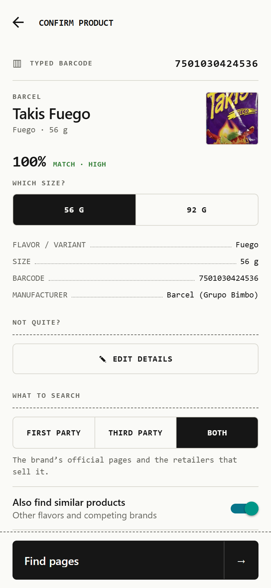
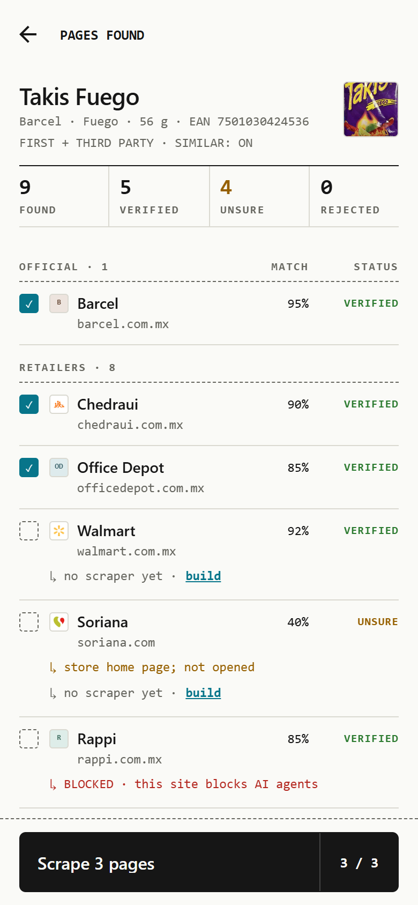
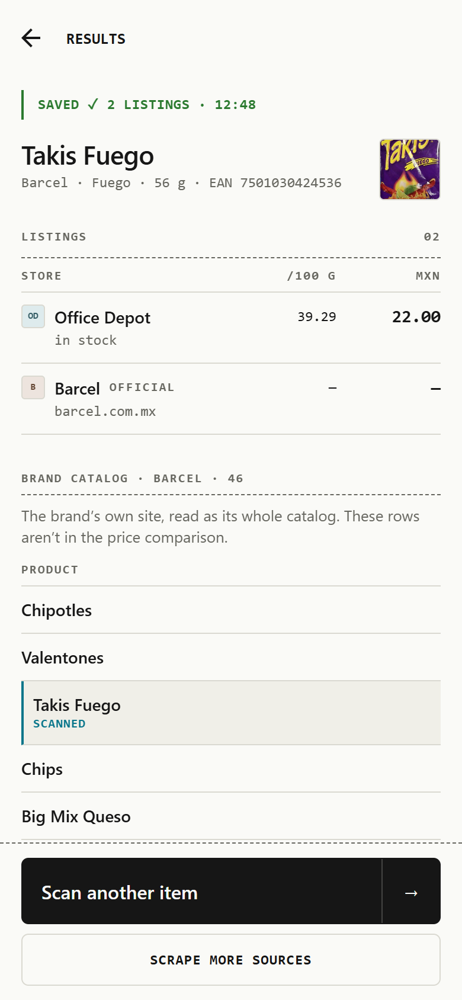
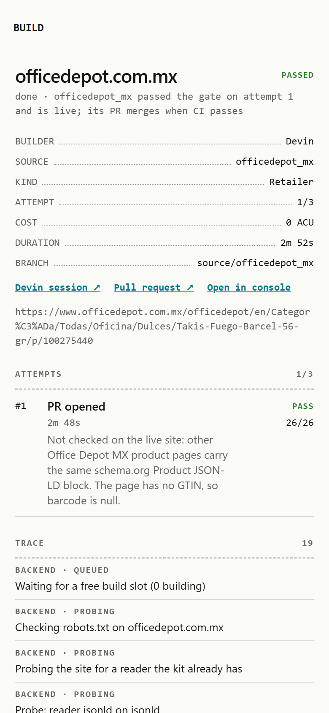
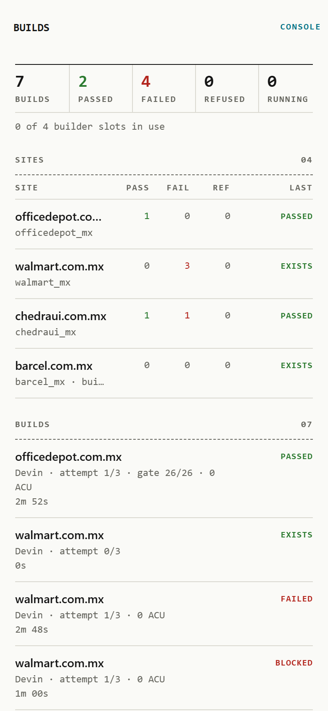
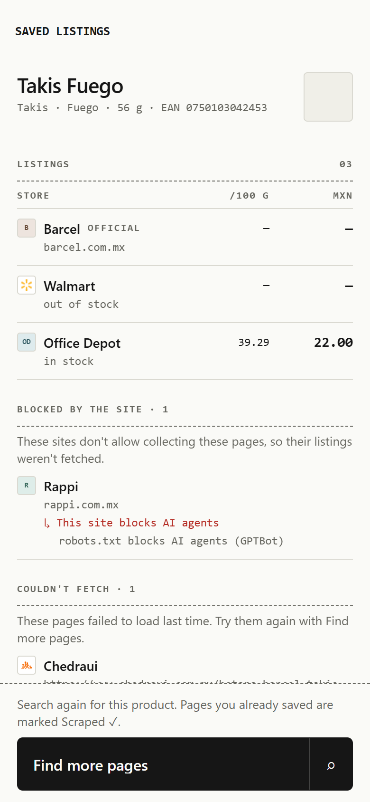
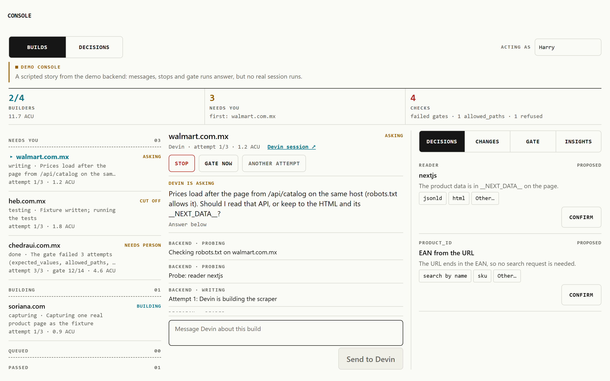
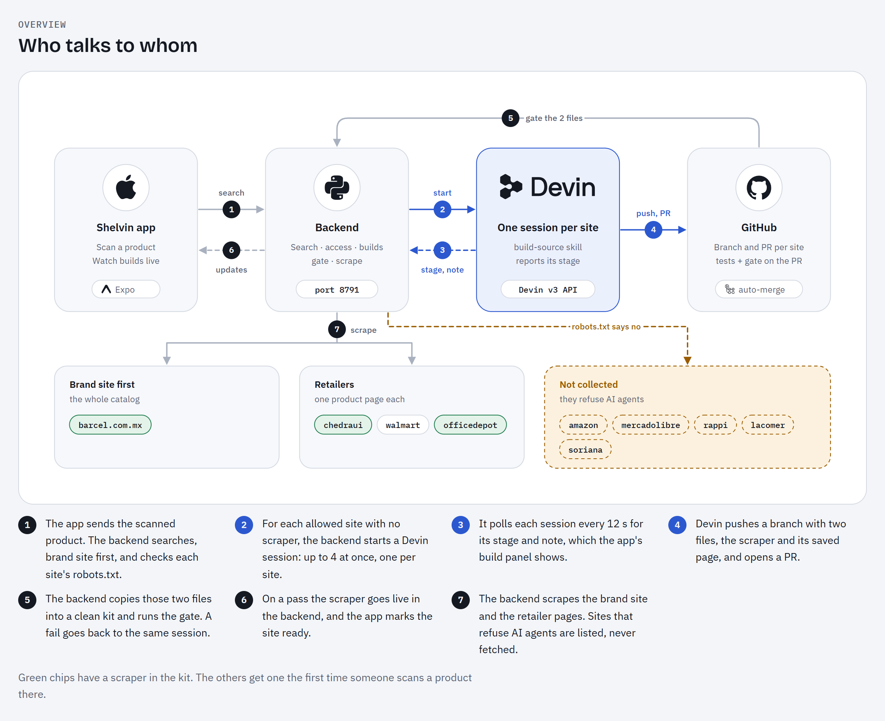

# Shelvin

**Shelvin** (shelf + Devin) is an iPhone app for retail in Mexico. Scan a product and Shelvin finds the brand's own
site first, then the Mexican retailers that sell it, and reads price and details from each page. When a site has no
scraper yet, a Devin session writes one, code checks it, and it is live for every later scan. Sites that refuse AI
agents are listed with an official alternative, never scraped.

Shelvin started at the Cognition hackathon in the team repo
[Mantis4Real/Cognition-Hackathon](https://github.com/Mantis4Real/Cognition-Hackathon).

<table>
  <tr>
    <td></td>
    <td></td>
    <td></td>
    <td></td>
  </tr>
  <tr>
    <td align="center">A scanned barcode, named with its pack photo</td>
    <td align="center">Pages found, blocked sites, scrapers to build</td>
    <td align="center">Listings per store</td>
    <td align="center">Devin's build, checked by the gate</td>
  </tr>
  <tr>
    <td></td>
    <td></td>
    <td colspan="2"></td>
  </tr>
  <tr>
    <td align="center">Every build and installed scraper</td>
    <td align="center">Saved listings, blocked and failed pages</td>
    <td align="center" colspan="2">The scraper console: Devin asks, a person confirms its decisions</td>
  </tr>
</table>

The app in a browser (Expo web) against a running backend. The first row is a real scan of Takis Fuego 56 g
(barcode 7501030424536): Open Food Facts gives the record and pack photo, Claude names the product. The console
shot uses the app's sample data.

## How it works



1. **Identify.** The phone reads the barcode or photo and names the product (Open Food Facts, then Claude).
2. **Search.** The backend finds the brand's site and retailer pages, and checks each site's robots.txt and AI-agent
   opt-outs.
3. **Build.** For an allowed site with no scraper, the backend starts a Devin session (v3 API) with the
   [build-source skill](.agents/skills/build-source/SKILL.md). Devin may change two paths only:
   `scraper-kit/sources/<site>.py` and its saved page in `scraper-kit/fixtures/<site>/`. It runs the gate and opens a PR.
4. **Gate.** The backend runs the gate itself on just those two files. A fail goes back to the same session, up to
   3 attempts. A pass puts the scraper live.
5. **Scrape.** The backend reads every page and the app shows price, price per 100 g, the retailer's category and
   the Google Product Taxonomy.

For Office Depot, one Devin session went from the build request to a live scraper in 2 min 51 s, and the backend's
gate passed 26/26 on the first attempt.

[docs/architecture.html](docs/architecture.html) has the diagrams: the flow, the build loop, the prompt Devin gets
and the kit it works in. GitHub shows HTML as source, so download it and open it in a browser.

## Repository

| Path | What |
|---|---|
| [`app/`](app/README.md) | The iPhone app: Expo, React Native, TypeScript. Also runs in a browser |
| [`backend/`](backend/README.md) | Python HTTP API on :8791: search, access checks, builds, the gate, scrapes. JSON files or Postgres |
| [`scraper-kit/`](scraper-kit/README.md) | The kit Devin builds with: probe, five generic readers, the gate, offline replay of saved pages. One module per site in `sources/` |
| [`.agents/skills/build-source/`](.agents/skills/build-source/SKILL.md) | The steps Devin follows for one build |
| [`.devin/blueprint.yaml`](.devin/blueprint.yaml) | Devin's machine setup for this repo |
| [`.github/workflows/`](.github/workflows/) | Kit tests on every PR; auto-merge of Devin's PRs (off) |
| [`tools/`](tools/) | [contract-check](tools/contract-check/README.md) (a running backend against the API contract) and the identification and search benchmarks |
| [`scripts/dev-up.sh`](scripts/dev-up.sh) | Starts the backend with free defaults and prints the app's settings |
| [`docs/`](#docs) | Architecture, running, agents, the API contract |

## Quick start

```bash
scripts/dev-up.sh                 # backend on :8791; free defaults: recorded searches and builds, JSON storage
cd app && npm install && npx expo start
```

Put the three lines dev-up prints into `app/.env` first. Without an `app/.env` the app runs on sample data and
needs no backend. With `AGENT=devin` and `DEVIN_API_KEY`, `DEVIN_ORG_ID` in your shell, builds run on Devin.
[docs/running.md](docs/running.md) has every option.

## Devin builds on a fork

Each Devin session clones a GitHub repo, writes the scraper there and opens a PR. By default that repo is
`HarryGomar/hackathon-devin-shelvin`, which your Devin org can't reach. On a fork, every build fails until you point
Devin at your fork:

1. **Fork** this repo and clone your fork. The backend's clone must have your fork as `origin`, because it fetches
   Devin's branches from there to run the gate.
2. **Give Devin access to the fork.** Devin works through its GitHub App. In Devin go to
   Settings → Integrations → GitHub and add the fork. That opens GitHub, where you install the app on the fork's
   owner (your user or org) for that repo. You can also go to
   [github.com/apps/devin-ai-integration](https://github.com/apps/devin-ai-integration) directly. Only the owner of
   the account the fork lives on can install the app.
3. **Tell the backend.** Put this in the shell or `backend/.env`, next to `DEVIN_API_KEY` and `DEVIN_ORG_ID`:
   ```bash
   AGENT=devin
   DEVIN_REPO=<you>/hackathon-devin-shelvin
   ```
4. **Turn on Actions** in the fork (the Actions tab). Forks start with them off, and the kit tests run on Devin's PRs.
   Auto-merge of those PRs is off on purpose. The backend's own gate is what puts a scraper live.
5. **Check it.** All lines should say `ok`. `devin repo` fails until step 2 is done, and `repo clone` until step 1:
   ```bash
   cd backend && uv run python -m server check
   ```

## Tests

```bash
cd app && npm run typecheck && npm run lint && npm test
cd backend && uv run --group dev pytest -q          # TEST_DATABASE_URL=… adds the Postgres tests
cd scraper-kit && uv run --group dev pytest -q
cd tools/contract-check && npm test
```

Node 22.15 needs `NODE_OPTIONS=--experimental-strip-types` for the TypeScript test runners.

## Docs

| Doc | What |
|---|---|
| [architecture.html](docs/architecture.html) | The system in diagrams |
| [running.md](docs/running.md) | Run it end to end, options, troubleshooting |
| [claude-and-devin.md](docs/claude-and-devin.md) | Claude ⇄ Devin switches, costs, safety |
| [api-contract.md](docs/api-contract.md) | Every endpoint and field between the app and the backend |
| [backend-spec.md](docs/backend-spec.md) | The backend's rules: auth, jobs, search, scrapers, persistence |
| [phone/expo-go.md](docs/phone/expo-go.md), [phone/iphone-checklist.md](docs/phone/iphone-checklist.md) | Running on an iPhone |

## Product photos and licenses

The identified product's photo is, in order: the Open Food Facts front image of the exact barcode, the best match
from an Open Food Facts search (brand, name, flavor and size, Mexico), or the user's own photo of the pack
(`ProductIdentity.imageSource` records which). Listing photos are each page's own image, from the backend's
scraper (`Listing.imageUrl`).

Images from [Open Food Facts](https://world.openfoodfacts.org) are licensed under
[CC BY-SA 3.0](https://creativecommons.org/licenses/by-sa/3.0/deed.en); the data is under the
[Open Database License](https://opendatacommons.org/licenses/odbl/1-0/). Credit "Open Food Facts" where these
images are shown.
